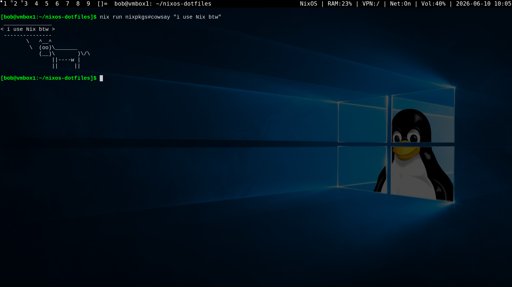

# NixOS Dotfiles

"I use Nix btw"



One desktop on both machines: **X11 + dwm**, no display manager (login on tty1,
`startx`). The Wayland session (dwl) that used to sit next to it is in the git
history.

## Layout

```
flake.nix                     host table + nixosSystem factory; no config here
modules/
  system/
    base.nix                  every host (flake imports it): boot, nix, users, tz
    desktop.nix               X on tty1, dwm/picom/slock, pipewire, fcitx5, lid
    forks.nix                 the src/ overlay, pulled in by desktop.nix
    network.nix               NetworkManager, tailscale, firewall trust
    docker.nix                daemon, group, compose CLI
    libvirtd.nix              qemu + virt-manager + dnsmasq + virbr0 (nixbox1)
    nvidia.nix                PRIME offload + the unfree grant (NVIDIA hosts)
  home/
    base.nix                  every user (flake imports it): shell, vim, CLI
    desktop.nix               the session, apps with windows, fonts, `vars.*`
hosts/<host>/
  configuration.nix           which services this machine runs, + its deltas
  home.nix                    facts: wallpaper, xrandr line
  hardware-configuration.nix  generated by nixos-generate-config
src/                          vendored C sources (dwm, st, slock, slstatus)
patches/                      where each local C change came from (see patches/README.md)
pics/                         wallpapers
```

Three rules: layers never reach across each other (`hosts/<name>/` knows nothing
about the WM or other hosts, a module knows nothing about a machine), host facts
arrive through options instead of hardcoding, and a service is a file a host
*names*. The flake imports only the two `base.nix` files, so a machine's whole
service list is visible in the first ten lines of its `configuration.nix`, and a
third machine that is, say, a headless box in the closet imports neither
`desktop.nix` nor `docker.nix` and gets no X server, no daemon, no groups. Each
module also carries the group its own service needs, which is why `base.nix` can
stay ignorant of what a host runs.

```nix
# hosts/nixbox1/configuration.nix
imports = [
  ../../modules/system/desktop.nix
  ../../modules/system/network.nix
  ../../modules/system/docker.nix
  ../../modules/system/libvirtd.nix
  ../../modules/system/nvidia.nix
];
services.xserver.xkb.layout = "jp"; # desktop.nix sets no keymap
```

The same goes for the user half: `modules/home/desktop.nix` declares
`vars.wallpaper` and `vars.xrandrArgs`, the host fills them in, and the same
module turns them into the session. Usernames work the same way: the host table
at the top of `flake.nix` is the only place `anon` appears.

```nix
# hosts/nixbox1/home.nix
imports = [ ../../modules/home/desktop.nix ];
vars.wallpaper = ../../pics/2077.png;
vars.xrandrArgs =
  "--output eDP-1 --auto --primary "
  + "--output HDMI-1-0 --mode 2560x1440 --rate 144 --right-of eDP-1";
```

The GPU splits the same way: `modules/system/nvidia.nix` holds the offload shape
and the `allowUnfreePredicate` that the driver needs, and *declares*
`video.prime.intelBusId` / `video.prime.nvidiaBusId` with no default, so every
NVIDIA host states its own PCI ids plus its driver generation (`open = true` on
nixbox1, `legacy_580` on nixbox2) instead of inheriting ids that happen to be
right twice. The flake passes `hostName` and `users` to every module as
`specialArgs`, so no module names a user or a machine.

## Hosts

| host    | notes                                |
| ------- | ------------------------------------ |
| nixbox1 | nvidia (open), JP, panel + HDMI, VMs |
| nixbox2 | nvidia (legacy 580), US, panel only  |

Adding a host: drop `hardware-configuration.nix` (from `nixos-generate-config`
on the box) plus a `configuration.nix` that imports the modules it needs and a
`home.nix` under `hosts/<name>/`, then add the entry to the host table. A missing
file or key fails evaluation instead of silently importing nothing -- including
the required ones: `vars.wallpaper`, and `video.prime.*` on an NVIDIA host.

## Vendored forks

`src/` holds hand-patched copies of dwm, st, slock and slstatus, defined once by
the overlay in `modules/system/forks.nix` -- imported by `desktop.nix`, and seen
by the home half too because `useGlobalPkgs` hands it the same package set (dwm
and slock from the system side, st and slstatus from the session).

* `patches = [ ]` — upstream's patch list is dropped: the hunks are already in
  the source, and upstream's list applies to the release tarball these trees were
  forked from. `patches/README.md` pins each fork's upstream base commit, lists
  what is genuinely local, and flags the upstream code that only *looks* local
  (dwm's `refreshrate`, its status-click fix, slock's ctrl-U).
* `version` comes from `src/<pkg>/config.mk`, the tree that actually compiles,
  with a `-local` suffix so a fork rebuild is visible in `nixos-rebuild` output
  (`dwm-6.8-local`) instead of being name-identical to upstream. Inheriting
  nixpkgs' version would drift silently (`../src/dwm` is 6.8, nixpkgs packages
  6.6).
* the source is filtered down to what the Makefile reads (`.c`, `.h`, `Makefile`,
  `config.mk`, `config.def.h`, the man page it installs, st's terminfo), so
  editing a doc or a patch note next to the source cannot rebuild a fork. Checked
  rather than assumed: appending to `src/st/FAQ` leaves `st`'s derivation path
  byte-identical. `src/slstatus/scripts/` is runtime config the session links,
  deliberately not a build input.

Rebasing a fork is a recipe with commands, not a paragraph: see *Rebasing a fork
onto newer upstream* in `patches/README.md`.

## Commands

Run from this repo; swap `nixbox1` for `nixbox2`.

```sh
nixos-rebuild switch --flake .#nixbox1        # build + activate
nixos-rebuild build  --flake .#nixbox1        # build only, change nothing
nixos-rebuild switch --flake .#nixbox1 next   # + set as default boot entry
nixos-rebuild reboot --flake .#nixbox1 next   # switch + reboot
nixos-rebuild dry-activate --flake .#nixbox1  # preview changes, touch nothing
nix eval ".#nixosConfigurations.nixbox2.config.system.build.toplevel.drvPath"  # check the other box
nix fmt                                       # nixfmt, pinned by this lock
```

Build fails → `--show-trace`. Bad switch → `sudo nixos-rebuild --rollback` (or
the previous systemd-boot entry).

### /etc/nixos is a symlink to this repo

`nixos-rebuild-ng` implies `--flake` when `/etc/nixos/flake.nix` exists and picks
`nixosConfigurations.<hostname>` (models.py, `_get_hostname`), so pointing
`/etc/nixos` here makes a bare `nixos-rebuild switch` mean *this* system's
switch. Once per host:

```sh
sudo mv /etc/nixos /etc/nixos.installer-backup   # the installer's own default config
sudo ln -s /home/$USER/nixos-dotfiles /etc/nixos
nixos-rebuild dry-activate                       # should name nixbox1, not "nixos"
```

Without the link, `/etc/nixos` keeps whatever the installer left there -- on both
boxes that was the stock `configuration.nix` with `networking.hostName = "nixos"`,
which a forgotten `--flake` would happily build and switch to. A path that
contains `.git` resolves to `git+file://`, so the working tree is used even when
dirty (`Revision: …-dirty`, verified); only `.gitignore`d files are left out, the
same content `--flake .` sees.

`nix.gc` runs weekly with 14-day retention; by hand: `sudo nix-collect-garbage -d`.

## State this repo does not own

Nothing here holds a secret, which also means `nixos-rebuild` alone does not
finish a fresh host. Out of the repo, on purpose:

* the account password -- `users.users.*` declares none, so a brand-new host has
  a **locked** account until it is set from a tty (`sudo passwd anon`);
* `sudo tailscale up`, once per host: `network.nix` enables the daemon, never
  the login;
* NetworkManager's saved Wi-Fi secrets (`/var/lib/NetworkManager`);
* libvirt's own tree (`/var/lib/libvirt`): VMs, networks, storage pools. The
  `iso` pool targets `~/Downloads/iso`, so that directory has to exist -- if it
  does not, libvirtd logs `Failed to autostart storage pool 'iso'` at every boot
  (`journalctl -b -p err`). `mkdir -p ~/Downloads/iso`, or drop the pool with
  `sudo virsh pool-undefine iso`.

A reformat loses all four; the password and the VMs are the two that hurt.

No CI, no linters, no `devShell` — this repo is only what the two machines need.
The one exception is `nix fmt`: the formatter is a flake output, so the tree's
style is checked by the same nixpkgs that builds it.
