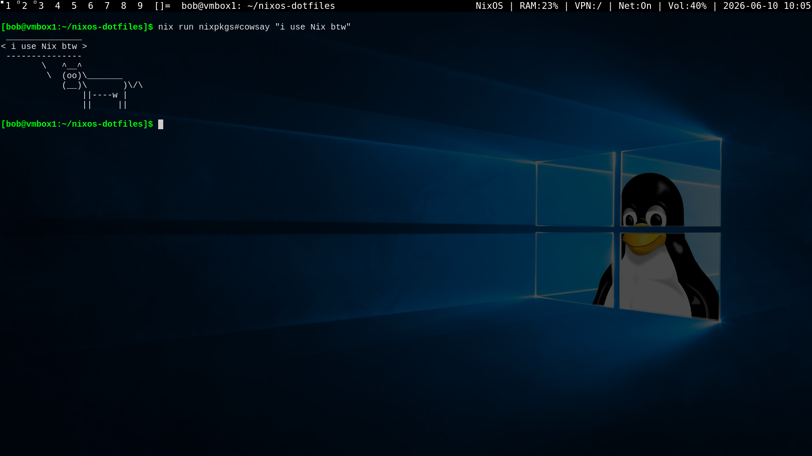

# NixOS Dotfiles

"I use Nix btw"



One desktop on both machines: **X11 + dwm** behind **ly** on tty1, no autologin,
and the session is home-manager's `~/.xsession`.

## Layout

```
flake.nix                     host table + nixosSystem factory; no config here
modules/
  system/
    base.nix                  every host (flake imports it): boot, nix, users, tz
    btrfs.nix                 zstd compression on /, /nix, /home
    desktop.nix               ly + X on tty1, dwm/picom/slock, pipewire, fcitx5, lid
    forks.nix                 the src/ overlay, pulled in by desktop.nix
    network.nix               NetworkManager, tailscale, firewall trust
    power.nix                 thermald, power-profiles-daemon, upower
    memory.nix                zram, for the swapless hosts
    docker.nix                daemon, group, compose CLI
    k8s.nix                   kubectl, helm, k9s, kind, flux
    libvirtd.nix              qemu + virt-manager + virbr0
    nvidia.nix                PRIME offload + the unfree grant
  home/
    base.nix                  every user (flake imports it): shell, vim, CLI
    desktop.nix               the session, apps with windows, fonts, `vars.*`
hosts/<host>/
  configuration.nix           which services this machine runs, + its deltas
  home.nix                    facts: wallpaper, xrandr line
  hardware-configuration.nix  generated by nixos-generate-config
src/                          vendored C sources (dwm, st, slock, slstatus)
patches/                      where each local C change came from (patches/README.md)
pics/                         wallpapers
```

Three rules: a module knows nothing about a machine, `hosts/<name>/` knows nothing
about the WM, and a service is a file a host *names*. The flake imports only the
two `base.nix` files, so a machine's whole service list is the first ten lines of
its `configuration.nix` -- a headless box imports neither `desktop.nix` nor
`docker.nix` and gets no X server, no daemon, no groups. Each module also carries
the group its own service needs, which is what lets `base.nix` stay ignorant.

```nix
# hosts/nixbox1/configuration.nix
imports = [
  ../../modules/system/desktop.nix
  ../../modules/system/network.nix
  ../../modules/system/docker.nix
];
services.xserver.xkb.layout = "jp"; # desktop.nix sets no keymap
```

Per-host facts are options rather than hardcoded values, and a required one fails
evaluation instead of defaulting: `vars.wallpaper` and `vars.xrandrArgs` for the
session, `video.prime.*BusId` for PRIME plus `hardware.nvidia.open` / `package`
for the driver generation.

```nix
# hosts/nixbox1/home.nix
imports = [ ../../modules/home/desktop.nix ];
vars.wallpaper = ../../pics/2077.png;
vars.xrandrArgs =
  "--output eDP-1 --auto --primary "
  + "--output HDMI-1-0 --mode 2560x1440 --rate 144 --right-of eDP-1";
```

`hostName` and `users` reach every module as `specialArgs` (`extraSpecialArgs` on
the home half), so the host table at the top of `flake.nix` is the only place a
hostname or a username appears.

## Session

```
ly                     PAM service `ly`, tty1, no autologin
└─ X                   displayManager.xserverBin/xserverArgs
   └─ xsession-wrapper /etc/profile, ~/.profile, ~/.xprofile, xrdb, sessionCommands
      └─ ~/.xsession   fcitx5, slstatus, xrandr, feh, xss-lock, then `dwm &` + wait
         └─ teardown   home-manager stops graphical-session{,-pre}.target
```

Four choices in it are deliberate:

* **no autologin** -- the password is what stands between a closed lid and the
  desktop, and a display manager gives it up for free.
* **`ly.settings.save = false`** -- the username box is a cyclable list that cannot be
  filtered, so this takes back the half that is: the prefill with the last user, and
  the `/etc/ly/save.txt` behind it (username + session index, in the clear, under
  `/etc`).
* **`ly.settings.shell = false`** -- ly runs that row through the same wrapper, which
  execs `~/.xsession` first, so it is only a second, misleading dwm. The debug shell
  is Ctrl+Alt+F2: logind instantiates `autovt@tty2`, and ly conflicts only with
  `autovt@tty1`.
* **`xsession.windowManager.command = ""`** -- the wrapper's last act is
  `eval exec ~/.xsession "$@"`, where `$1` is the generated session script, so
  home-manager's default `test -n "$1" && eval "$@"` would run a second dwm at logout.

Session output goes to the journal, not `~/.xsession-errors`:

```sh
journalctl -t xsession          # fcitx5, slstatus, xrandr, dwm
journalctl -t xserver-wrapper   # the X server
journalctl -u display-manager   # ly as a unit; ly's own log is /var/log/ly.log
```

## Hosts

| host    | notes                                |
| ------- | ------------------------------------ |
| nixbox1 | nvidia (open), JP, panel + HDMI, VMs |
| nixbox2 | nvidia (legacy 580), US, panel only  |

Adding a host: `hardware-configuration.nix` from `nixos-generate-config` on the
box, a `configuration.nix` importing the modules it needs, a `home.nix`, and a row
in the host table.

## Vendored forks

`src/` holds hand-patched dwm, st, slock and slstatus, defined once by the overlay
in `modules/system/forks.nix` -- imported by `desktop.nix`, and seen by the home
half too because `useGlobalPkgs` hands it the same package set.

* `patches = [ ]` -- the hunks are already in the source, and upstream's list applies
  to the release tarball these trees were forked from.
* `version` comes from `src/<pkg>/config.mk`, the tree that actually compiles, plus a
  `-local` suffix so a fork rebuild shows up in `nixos-rebuild` output
  (`dwm-6.8-local`) instead of drifting silently from nixpkgs' version.
* The source is filtered to what the Makefile reads (`.c`, `.h`, `Makefile`,
  `config.mk`, `config.def.h`, the man page, st's terminfo), so editing a doc next to
  the source cannot rebuild a fork.

`patches/README.md` pins each base commit, says what is genuinely local, flags the
upstream code that only *looks* local, and has the commands to verify or rebase.

## Commands

Run from this repo; swap `nixbox1` for `nixbox2`.

```sh
nixos-rebuild switch --flake .#nixbox1        # build + activate
nixos-rebuild build  --flake .#nixbox1        # build only, change nothing
nixos-rebuild switch --flake .#nixbox1 next   # + set as default boot entry
nixos-rebuild reboot --flake .#nixbox1 next   # switch + reboot
nixos-rebuild dry-activate --flake .#nixbox1  # preview changes, touch nothing
nix eval ".#nixosConfigurations.nixbox2.config.system.build.toplevel.drvPath"  # check the other box
nix fmt                                       # nixfmt-tree, pinned by this lock
nix fmt -- --fail-on-change                   # the same, as a gate: fail, don't rewrite
```

`rebuild`, from `modules/home/base.nix`, is
`sudo nixos-rebuild switch --flake ~/nixos-dotfiles#<this host>`: the host name
comes from the host table and the flake is an absolute path, so it is correct on
whichever box you are typing on and works from any directory.

Build fails → `--show-trace`. Bad switch → `sudo nixos-rebuild --rollback` (or the
previous systemd-boot entry).

### /etc/nixos is a symlink to this repo

`nixos-rebuild-ng` implies `--flake` when `/etc/nixos/flake.nix` exists and picks
`nixosConfigurations.<hostname>`, so a bare `nixos-rebuild switch` means *this*
system's switch. Once per host:

```sh
sudo mv /etc/nixos /etc/nixos.installer-backup   # the installer's own default config
sudo ln -s /home/$USER/nixos-dotfiles /etc/nixos
nixos-rebuild dry-activate                       # should name nixbox1, not "nixos"
```

Without the link, a forgotten `--flake` builds whatever the installer left in
`/etc/nixos` -- on both boxes, the stock config with `networking.hostName = "nixos"`.
A path containing `.git` resolves to `git+file://`, so a dirty working tree is still
what gets built.

`nix.gc` runs weekly with 14-day retention; by hand: `sudo nix-collect-garbage -d`.

### Two nixpkgs inputs, and they do not move together

`opencode` is the only package built from the second one (`pkgsUnstable` in
`flake.nix`), and it deliberately does not `follows = nixpkgs`, or the pin would drag
it back.

```sh
nix flake update nixpkgs-unstable   # opencode alone; the system does not move
nix flake update nixpkgs            # updates inside nixos-26.05 (home-manager follows it)
nix flake update                    # both -- only when you mean it
```

One input per commit, so `git log` names the bump that broke something;
`--commit-lock-file` does the update and the commit in one step. A bad bump is
`sudo nixos-rebuild --rollback` or `git checkout HEAD~1 -- flake.lock` + rebuild.

## CI

`.github/workflows/check.yml`, on every push to `main` and every PR: the format gate,
then `nix eval` of both hosts' toplevel `drvPath`. Evaluation only, no builds. Nothing
else -- no linters, no `devShell`: this repo is only what the two machines need.

## State this repo does not own

Nothing here holds a secret, which also means `nixos-rebuild` alone does not finish a
fresh host. Out of the repo, on purpose:

* the account password -- `users.users.*` declares none, so a brand-new host has a
  **locked** account until it is set from a tty (`sudo passwd anon`);
* `sudo tailscale up`, once per host: `network.nix` enables the daemon, never the login;
* NetworkManager's saved Wi-Fi secrets (`/var/lib/NetworkManager`);
* libvirt's own tree (`/var/lib/libvirt`). Its `iso` pool targets `~/Downloads/iso`,
  so that directory has to exist or libvirtd logs a failed-pool-autostart error at
  every boot: `mkdir -p ~/Downloads/iso`, or `sudo virsh pool-undefine iso`.

A reformat loses all four; the password and the VMs are the two that hurt.
